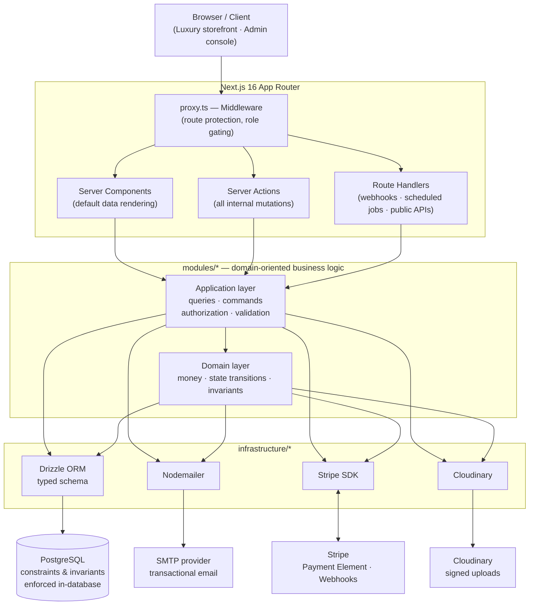
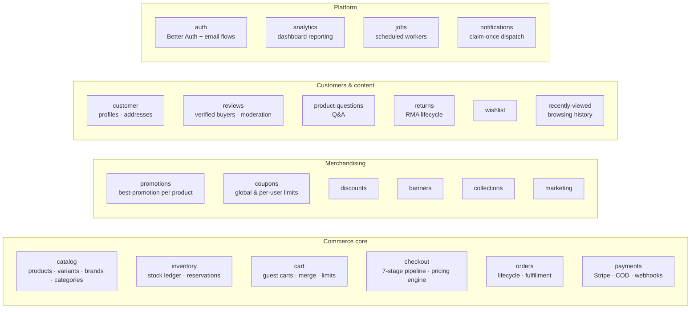
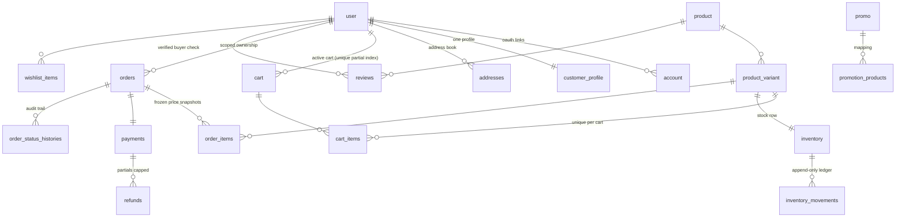
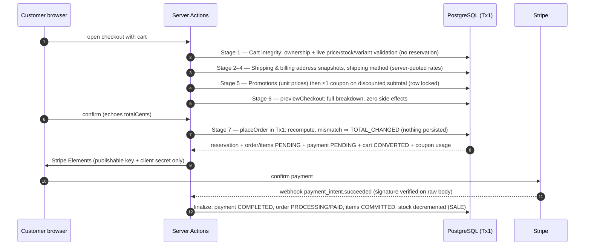
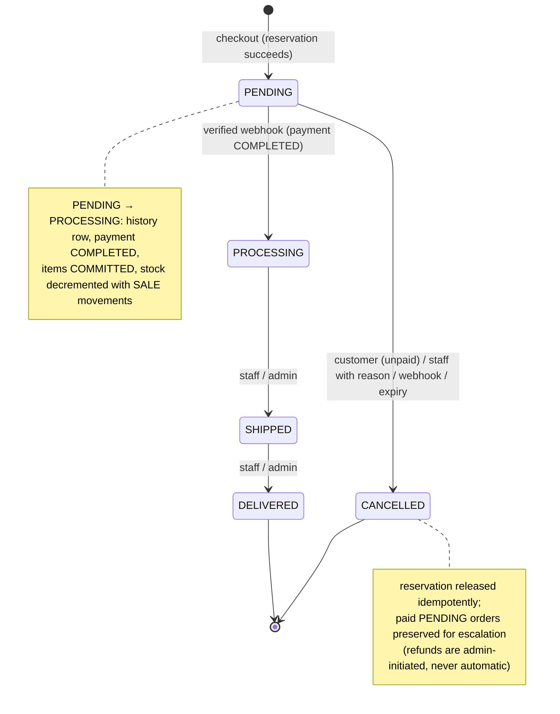
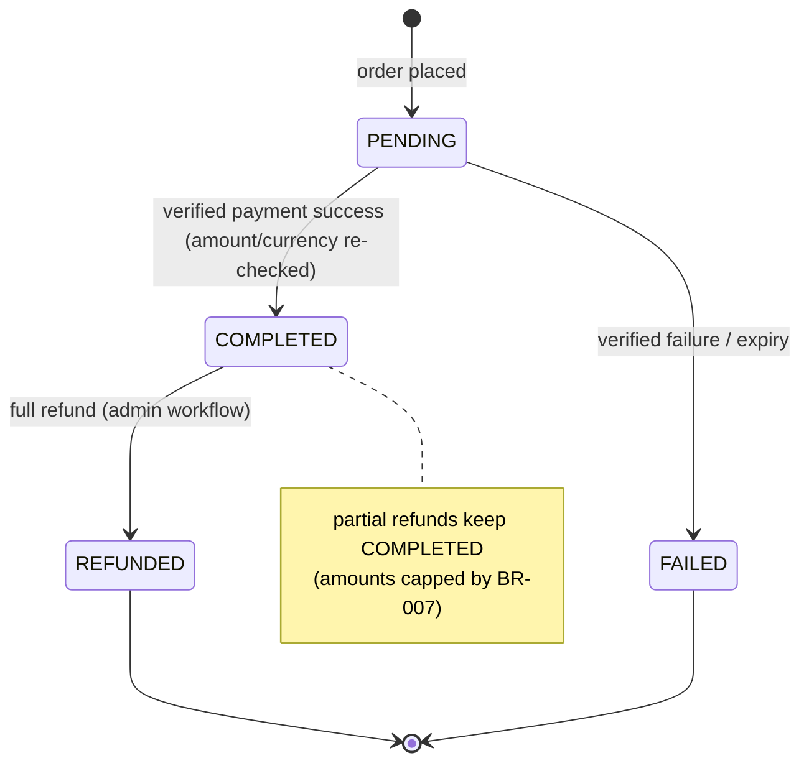
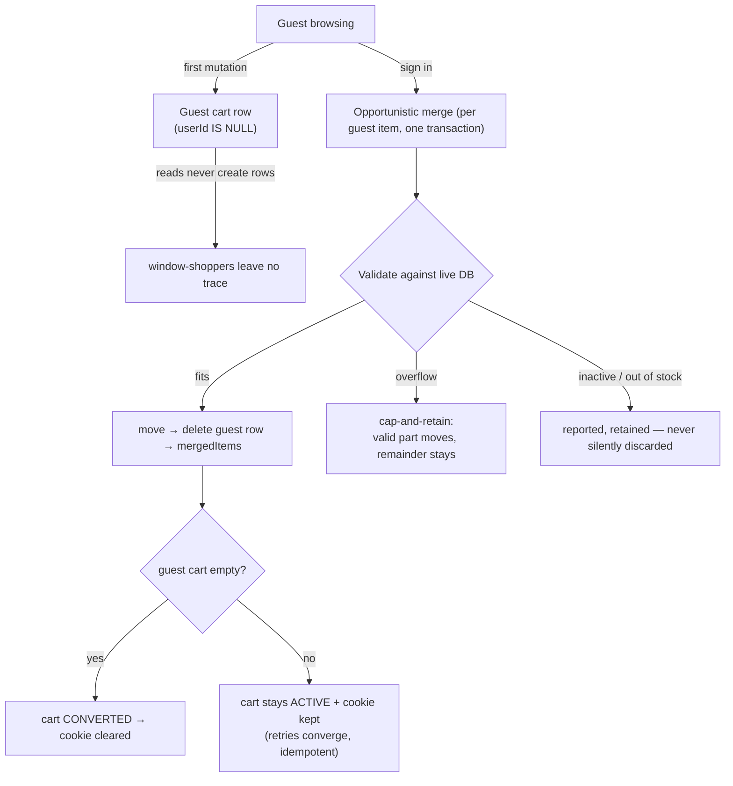
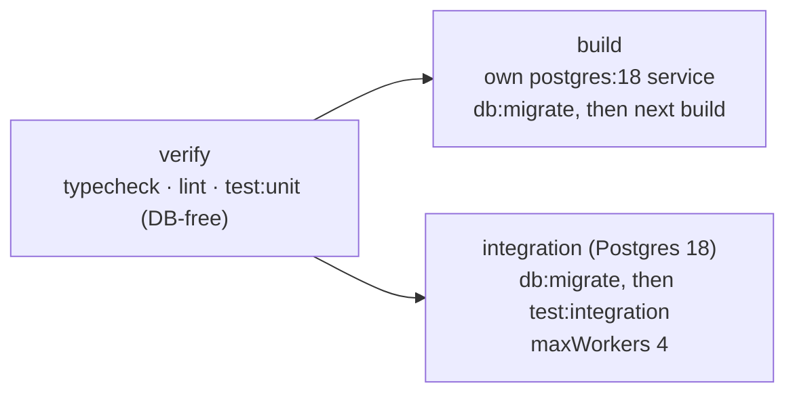

<div align="center">

# VELORA

**A luxury e-commerce platform — modular monolith on Next.js 16**

Production-oriented retail flow: catalog, inventory reservations, cart & guest checkout,
Stripe payments, promotions & coupons, reviews & Q&A, returns, notifications,
and a role-gated administration area.

Next.js 16 · React 19 · TypeScript · PostgreSQL · Drizzle ORM · Better Auth · Stripe · Cloudinary

</div>

---

## Table of contents

- [System architecture](#system-architecture)
- [Domain module map](#domain-module-map)
- [Data model overview](#data-model-overview)
- [Core business flows](#core-business-flows)
  - [Checkout & order creation](#checkout--order-creation)
  - [Order state machine](#order-state-machine)
  - [Payment state machine](#payment-state-machine)
  - [Cart lifecycle & guest merge](#cart-lifecycle--guest-merge)
  - [Inventory model](#inventory-model)
- [Administration & security posture](#administration--security-posture)
- [Getting started](#getting-started)
- [Environment](#environment)
- [Scripts](#scripts)
- [Database workflow](#database-workflow)
- [Testing](#testing)
- [CI pipeline](#ci-pipeline)
- [Documentation](#documentation)
- [Contributor conventions](#contributor-conventions)

---

## System architecture

VELORA is a **modular monolith with a domain-oriented layout** (see
[`ARCHITECTURE.md`](./ARCHITECTURE.md) for the decision record). Feature code lives in
`modules/<domain>`, categorized by a deliberate internal layering: presentation, application
(queries/commands + authorization + validation), domain rules, and Drizzle persistence.



**Key rules** (binding, from [`AGENTS.md`](./AGENTS.md)):

- Server Components by default; client components only where interaction genuinely requires them.
- Server Actions for internal mutations; Route Handlers only for external boundaries (Stripe webhooks, cron endpoints).
- Authorization, validation, pricing, and sensitive decisions live **on the server** — no client-supplied price, total, stock, or permission is ever trusted.
- Integrity rules are enforced **in the database as well** (uniques, checks, FK topology); money math uses exact decimals (`decimal.js`), never binary floating point.

---

## Domain module map

`modules/` is the heart of the application. Every domain follows the same internal layering,
so call sites and tests look alike across domains.



| Module group | Responsibility highlights |
| --- | --- |
| **Commerce core** | Catalog authority, `available = quantity − reserved_quantity`, atomic reservations, seven-stage checkout, order fulfillment matrix, payment terminal guards |
| **Merchandising** | Deterministic best-promotion selection, exactly-one-coupon stacking, collections & banners |
| **Customers & content** | Server-scoped ownership, review moderation, refund-request workflow, Q&A |
| **Platform** | Verified Better Auth sessions, claim-once notification emails, cron endpoints behind `CRON_SECRET` |

---

## Data model overview

Schema source of truth: TypeScript in [`infrastructure/database/schema/`](./infrastructure/database/schema).
Simplified relational overview of the central tables (not exhaustive):



Notable integrity properties (verified against migrations and docs/db-integrity.md):

- One `ACTIVE` cart per user and per guest — partial unique indexes (`cart_user_active_unique`, `cart_guest_active_unique`).
- `order_items` unique on `(order_id, variant_id)`; orders carry an `idempotency_key` (NOT NULL), making placement replay-safe.
- Snapshot columns on financial records (prices, taxes, addresses) are **immutable history** — historical rows are never repriced.
- Guest carts are real rows (`userId IS NULL`, opaque signed cookie), sharing one transactional path with user carts.

---

## Core business flows

### Checkout & order creation

Seven strictly ordered server-enforced stages (details in [`docs/checkout.md`](./docs/checkout.md)):



Highlights:

- **Placement is idempotent** — same inputs ⇒ same idempotency key ⇒ replay-safe; `order_row FOR UPDATE` before inventory, inventory rows locked in sorted variant order (deadlock-free global order).
- **Price-change confirmation** — any drift between preview and placement aborts pre-commit with `TOTAL_CHANGED`; the UI reconfirms against a fresh preview.
- **Financial formulas** blend exact decimal math with explicit `ROUND_HALF_UP`-once-per-aggregate boundaries:

```text
Subtotal       = Σ(quantityᵢ × unitPriceᵢ)
DiscountAmount = PromotionDiscount + CouponDiscount     (coupon ≤ subtotal)
TaxableBase    = Subtotal − DiscountAmount + TaxableShipping
TaxAmount      = round_half_up(TaxableBase × TaxRate)
TotalAmount    = Subtotal − DiscountAmount + ShippingAmount + TaxAmount
```

- **Cards & wallets** flow through Stripe Payment Element (automatic payment methods — no per-wallet code). **Cash on Delivery** never touches Stripe: it ships from `PENDING` and money is recorded exclusively through the admin `collectCodPayment` operation.
- **Promotion → coupon stacking** is structurally single-coupon: promotions adjust effective unit prices first; one coupon computes on the discounted merchandise subtotal only.

### Order state machine

The single authority is `modules/orders/*` transitions (details in [`docs/orders.md`](./docs/orders.md));
anything outside the matrix throws `InvalidOrderTransitionError` — clients cannot submit statuses.



- Every transition writes an audit row (`order_status_histories`) with `actor_type`
  (`customer|staff|admin|webhook|system`) and a `correlation_id` — in the same transaction.
- Late verified payments against cancelled/expired orders are rejected loudly — no fulfillment without stock.

### Payment state machine

Authority: `modules/payments/domain/payment-transitions.ts`.
Terminal guards prevent stale failure events from downgrading captured money
(details in [`docs/checkout.md`](./docs/checkout.md), [`docs/reliability.md`](./docs/reliability.md)).



- Webhook signature is verified against the **raw request body** before any processing.
- Event amount/currency are re-checked against persisted records post-lock — mismatches abort before mutation.
- Stripe intents are recreated from the **persisted** order total only (`checkout-{orderId}` idempotency; retries retrieve rather than recreate).

### Cart lifecycle & guest merge

Guest carts are server-side rows behind a signed, opaque cookie
(`base64url(JSON).base64url(HMAC-SHA256)`, `timingSafeEqual`-verified)
— details in [`docs/cart-lifecycle.md`](./docs/cart-lifecycle.md).



- `available = quantity − reserved_quantity` is rechecked, but **a cart is not a reservation** —
  cart writes deliberately never lock inventory rows; final order creation reserves atomically.
- Limits are server-enforced: per-item quantity `[1, 99]` (DB `CHECK quantity ≥ 1`), ≤ 50 distinct variants per cart, `(cart_id, variant_id)` unique index as the final backstop.

### Inventory model

Authoritative rules in [`docs/inventory.md`](./docs/inventory.md); enforcement in
`services/inventory.service.ts` with `FOR UPDATE` row locks inside one transaction:

```text
available = quantity − reserved_quantity          (never negative)

adjustStock       (delta): quantity + delta − reserved ≥ 0
setStock       (absolute): quantity ≥ reserved
adjustReservation (delta): reserved + delta ≥ 0  ∧  reserved + delta ≤ quantity
```

- Every successful mutation appends to `inventory_movements` (append-only ledger; the `inventory` row holds the live balance).
- Cache invalidation (`variants:product:{id}` → `variant:{variantId}` → `product:{id}` → `products:listing`) runs **only after a committed mutation** — failures never touch the cache.

---

## Administration & security posture

- **Server-enforced RBAC.** `requireAdmin` + middleware (`proxy.ts`) gate `/admin`; every protected mutation re-checks authorization server-side — hiding UI controls is not protection.
- **Ownership scoping.** Identity always comes from the verified Better Auth session; client-supplied user/cart/order ids are ignored. Foreign ids answer identically ("not found") — no ownership oracle.
- **Fail-closed configuration.** `config/env.ts` validates the environment at import time and exits on unknown/invalid values; tax rates are only applied from an *approved jurisdiction table* (`UNCONFIGURED` ⇒ explicit 0 bps, never an invented rate).
- **Audited money.** Coupons consumed under row locks in Tx1; refunds admin-only via `requestRefund` (partials capped, webhook-reconciled); COD cash recorded exclusively through `collectCodPayment` with `payment_collected` audit rows.
- **Claim-once notifications.** `orders` emails (`order_notifications`, unique per order+type) dispatch post-commit with SMTP outside every transaction; `SENT` is recorded only after provider acceptance — retries cannot double-send.

---

## Getting started

### Prerequisites

- Node.js **22** (matches CI)
- **pnpm** — pinned via `packageManager` (`pnpm@11.20.0`, use corepack)
- PostgreSQL 16+ (development verified on 18.x)

### Setup

```bash
# 1. Install dependencies
pnpm install

# 2. Configure the environment (see the table below; .env.example is the template)
cp .env.example .env

# 3. Apply the database schema (Drizzle migrator; fails closed on error)
pnpm db:migrate

# 4. Start the development server
pnpm dev
```

Open [http://localhost:3000](http://localhost:3000) — the admin console lives at `/admin`.

> **Existing databases** provisioned previously via `drizzle-kit push` should record the regenerated
> baseline as applied instead of re-running `pnpm db:migrate`. Operator guidance:
> [`docs/staging.md`](./docs/staging.md) · [`docs/db-integrity.md`](./docs/db-integrity.md)

### Production build constraints

`next build` prerenders catalog surfaces that query through `DATABASE_URL`, so a live database
must be reachable at build time (this is what the CI `build` job provisions). Next.js defaults to
Turbopack; static marketing assets live in `shared/images` and are imported via the `@/` alias.

---

## Environment

The environment is validated **at import time** by [`config/env.ts`](./config/env.ts) — the process
exits on invalid or unknown values, so every runtime (app, tests, migration runner, build) needs a
complete set. `.env.<NODE_ENV>` then `.env` are loaded and expanded; CI supplies labelled,
non-production placeholder fallbacks until real secrets are configured. Never commit real `.env` files.

| Variable | Required | Purpose |
| --- | --- | --- |
| `DATABASE_URL` | ✅ | PostgreSQL connection string |
| `BETTER_AUTH_SECRET` / `BETTER_AUTH_API_KEY` / `BETTER_AUTH_URL` | ✅ | Better Auth configuration |
| `SMTP_HOST` / `SMTP_USER` / `SMTP_PASS` | ✅ | Transactional email |
| `CLOUDINARY_CLOUD_NAME` / `CLOUDINARY_API_KEY` / `CLOUDINARY_API_SECRET` | ✅ | Signed media uploads |
| `STRIPE_SECRET_KEY` / `STRIPE_PUBLISHABLE_KEY` / `STRIPE_WEBHOOK_SECRET` | optional | Live checkout + webhooks |
| `SMTP_PORT` / `SMTP_SECURE` / `SMTP_FROM` | optional | Mail tuning (587 / STARTTLS / `Velora <SMTP_USER>`) |
| `CLOUDINARY_UPLOAD_PRESET` | optional | Upload preset override |
| `CRON_SECRET` | optional | Internal scheduled-job endpoints |
| `NOTIFICATION_BATCH_SIZE` / `NOTIFICATION_MAX_ATTEMPTS` / `NOTIFICATION_LEASE_MINUTES` | optional | Notification retry worker |
| `RESERVATION_EXPIRY_MINUTES` / `EXPIRED_RESERVATION_BATCH_SIZE` / `EXPIRED_RESERVATION_MAX_RETRIES` | optional | Reservation lifecycle worker |
| `LOW_STOCK_ALERT_RECIPIENTS` | optional | Low-stock alert delivery |
| `GUEST_CART_SECRET` | production | Guest cart cookie integrity (dev/test placeholder) |
| `VELORA_TEST_DATABASE_URL` | tests | Integration test target database |

---

## Scripts

| Script | Purpose |
| --- | --- |
| `pnpm dev` | Development server (Turbopack) |
| `pnpm build` | Production build |
| `pnpm start` | Production server |
| `pnpm lint` | ESLint over the repository |
| `pnpm typecheck` | `tsc --noEmit` |
| `pnpm test` | All Vitest suites |
| `pnpm test:unit` | Unit suites (no database required) |
| `pnpm test:integration` | Database-backed suites (`VELORA_TEST_DATABASE_URL`) |
| `pnpm test:watch` / `pnpm test:ui` | Vitest watch mode / dashboard |
| `pnpm db:generate` | Generate migration SQL from the schema |
| `pnpm db:migrate` | Apply migrations (each file in its own transaction; exit 1 on failure) |
| `pnpm db:push` | Sync the schema directly to a database |
| `pnpm db:update` | `db:generate` + `db:push` |

---

## Database workflow

- **Schema source of truth:** TypeScript declarations in [`infrastructure/database/schema/`](./infrastructure/database/schema); migrations are generated with `pnpm db:generate`.
- **Migration runner** (`pnpm db:migrate`) applies the journal, one file per transaction, and **fails closed** — an unapplied migration is an error, never a silent skip.
- **Consequence-drift protection:** the pre-regeneration journal is archived read-only in `infrastructure/database/drizzle-legacy/` for provenance; fresh databases start from a baseline generated directly from the TypeScript schema.
- **Integrity in the database:** FK topology, unique constraints, and CHECKs mirror the application invariants; orders record `idempotency_key` (NOT NULL) and `order_items` are unique per `(order_id, variant_id)`.
- **Money is decimal:** all monetary math uses `decimal.js` and integer minor units — never binary floats.

---

## Testing

Vitest. The suite splits by dependency and cost:

| Suite | Command | Database? | Notes |
| --- | --- | --- | --- |
| Unit | `pnpm test:unit` | ❌ none | Domain math, schemas, transitions — contributor-verifiable without Postgres |
| Integration | `pnpm test:integration` | ✅ one shared DB | `--maxWorkers 4` pins concurrency; suites purge their own fixtures |

```bash
# Integration against a migrated database
VELORA_TEST_DATABASE_URL=postgresql://… pnpm test:integration
```

Per the project's test discipline: regression tests are added for every bug fix; unauthorized
operations are tested at the server boundary (including direct action calls); failure paths,
duplicates, retries, and boundary conditions are exercised where relevant. On memory-constrained
machines prefer `--maxWorkers=2`.

---

## CI pipeline

[`.github/workflows/ci.yml`](./.github/workflows/ci.yml) runs on every push to `main` and on pull requests:



- The **build** job provisions its own Postgres because the prerender pass executes `unstable_cache`
  catalog queries against `DATABASE_URL`; `pnpm db:migrate` runs first as a schema check.
- The **integration** job pins `--maxWorkers 4`: every suite shares **one** database per run, and
  hammering every core with forks is the documented contention class.
- Repository secrets are optional — each job falls back to labelled non-production placeholders so
  fork/PR runs stay green before operations configure secrets.

---

## Documentation

The [`docs/`](./docs) directory is authoritative for behaviors; highlights:

| Document | Area |
| --- | --- |
| [`ARCHITECTURE.md`](./ARCHITECTURE.md) | Architecture decision record and layering rules |
| [`SRS.md`](./SRS.md) | Software requirements specification (FR/BR numbering used across docs) |
| [`docs/checkout.md`](./docs/checkout.md) | Checkout pipeline, pricing engine, payment processing |
| [`docs/orders.md`](./docs/orders.md) | Order lifecycle, cancellation, audit history |
| [`docs/cart-lifecycle.md`](./docs/cart-lifecycle.md) | Guest carts, merge, limits, snapshots |
| [`docs/inventory.md`](./docs/inventory.md) | Availability invariant, ledger, future fulfillment |
| [`docs/coupons.md`](./docs/coupons.md) / [`docs/promotions.md`](./docs/promotions.md) | Discount stacking |
| [`docs/returns.md`](./docs/returns.md) / [`docs/returns-policy.md`](./docs/returns-policy.md) | Returns |
| [`docs/reviews.md`](./docs/reviews.md), [`docs/banners.md`](./docs/banners.md), [`docs/collections.md`](./docs/collections.md), [`docs/wishlist.md`](./docs/wishlist.md), [`docs/recently-viewed-products.md`](./docs/recently-viewed-products.md), [`docs/analytics.md`](./docs/analytics.md) | Feature references |
| [`docs/db-integrity.md`](./docs/db-integrity.md) | Constraints, orphan policy, migration guidance |
| [`docs/staging.md`](./docs/staging.md) | Staging delivery and migration practice |
| [`docs/production-readiness.md`](./docs/production-readiness.md) | Launch gates |
| [`docs/EXPIRED_RESERVATIONS_OPERATIONS.md`](./docs/EXPIRED_RESERVATIONS_OPERATIONS.md) | Reservation worker operations |
| [`docs/deployment/`](./docs/deployment) | Deployment notes |

---

## Contributor conventions

[`AGENTS.md`](./AGENTS.md) is the binding engineering rulebook. The short version:

1. **Inspect before changing** — read the domain's existing queries, commands, validators, and tests first.
2. **Reuse first** — no parallel implementations of queries, validation, cache tags, or upload flows.
3. **Server-side authority** — authorization, pricing, and validation never live in the browser.
4. **Protect data** — additive reviewed migrations only; never rewrite historical migrations; preserve financial snapshots.
5. **Verify honestly** — run the relevant checks and report exact commands and results; no false completion.
6. **Keep diffs reviewable** — no speculative features, no unrelated refactors.
