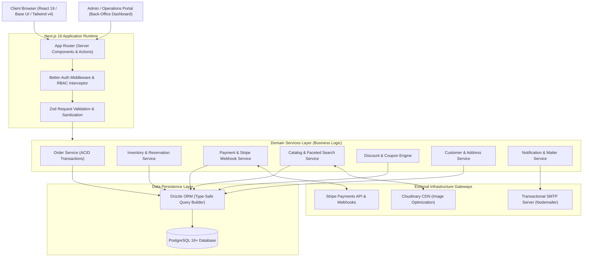
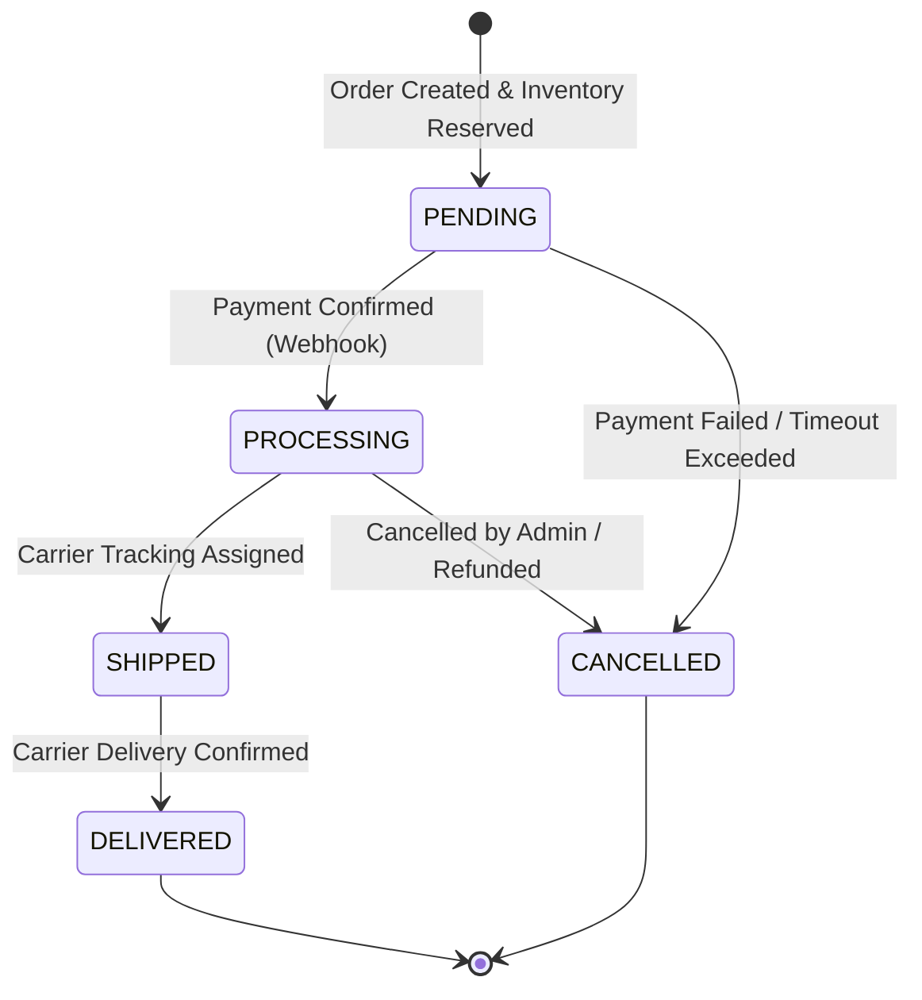
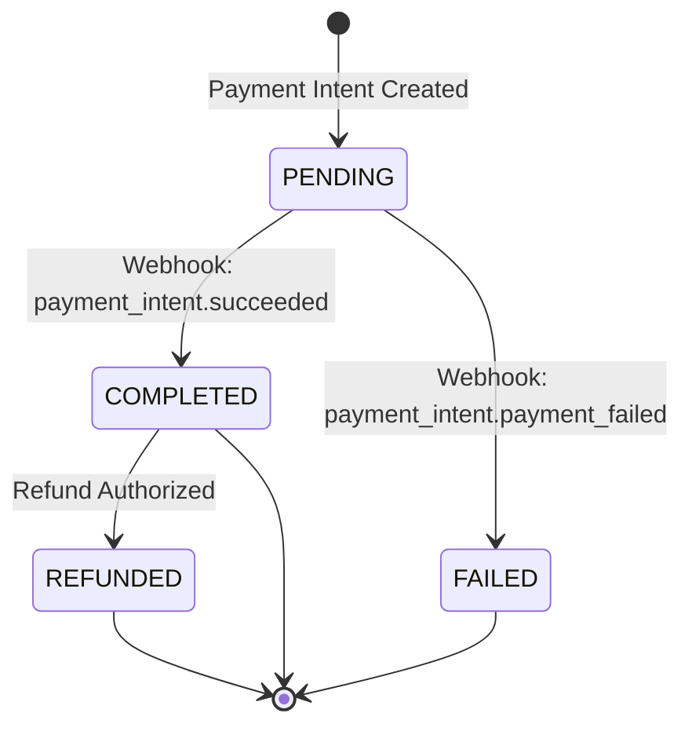
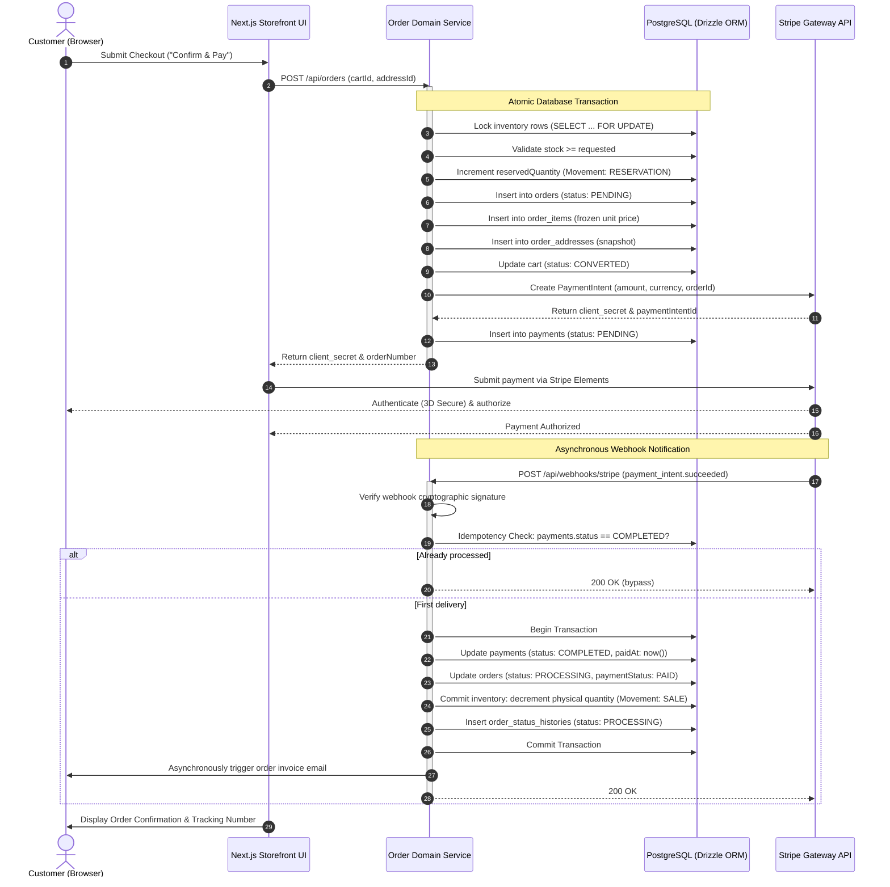
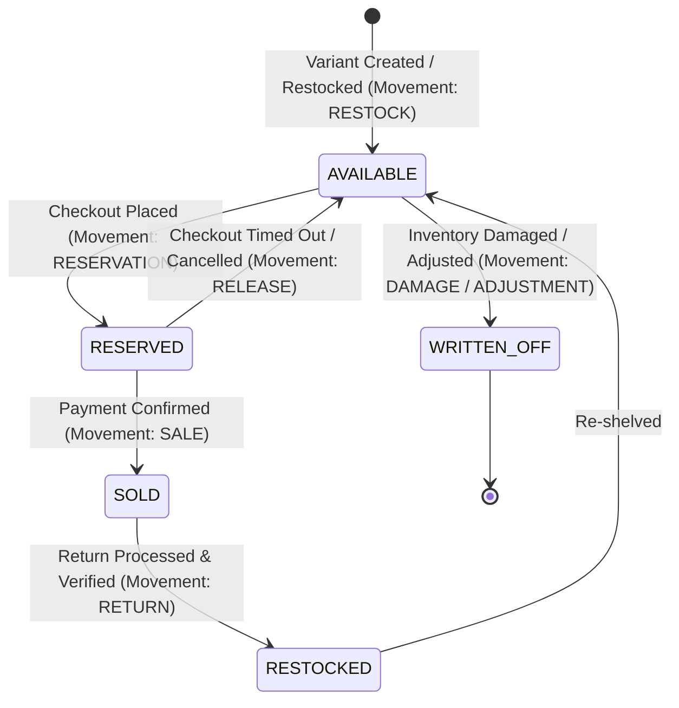

# Software Requirements Specification (SRS)
## Velora E-Commerce Platform

---

### Document Control & Metadata

| Attribute | Specification Details |
| :--- | :--- |
| **System Name** | Velora E-Commerce Platform |
| **Document Version** | 1.0.0 (Engineering Baseline) |
| **Standard Compliance** | IEEE 830 / ISO/IEC/IEEE 29148 Standard for Software Requirements Specifications |
| **Status** | Approved for Implementation |
| **Target Runtime Environment** | Next.js 16 (App Router), React 19, Node.js LTS, TypeScript (Strict Mode) |
| **Data Layer & ORM** | PostgreSQL 16+, Drizzle ORM (`drizzle-orm`, `drizzle-kit`) |
| **Authentication Engine** | Better-Auth with Drizzle PostgreSQL Adapter |
| **External Integrations** | Stripe Payments API & Webhooks, Cloudinary CDN, Nodemailer SMTP Gateway |
| **Target Audience** | Software Architects, Full-Stack Engineers, QA Engineers, DevOps, Product Managers |

---

## Table of Contents

1. [Introduction & System Overview](#1-introduction--system-overview)
   - 1.1 [Document Purpose](#11-document-purpose)
   - 1.2 [Document Conventions & Requirement Levels](#12-document-conventions--requirement-levels)
   - 1.3 [Intended Audience & Reading Suggestions](#13-intended-audience--reading-suggestions)
   - 1.4 [Product Scope & Business Objectives](#14-product-scope--business-objectives)
   - 1.5 [System Context & Architectural Overview](#15-system-context--architectural-overview)
   - 1.6 [User Classes & Role-Based Access Control (RBAC)](#16-user-classes--role-based-access-control-rbac)
   - 1.7 [Domain Glossary & Definitions](#17-domain-glossary--definitions)
2. [High-Level Technical Architecture](#2-high-level-technical-architecture)
   - 2.1 [Layered Application Architecture](#21-layered-application-architecture)
   - 2.2 [Data Model Architecture & Database Schemas](#22-data-model-architecture--database-schemas)
3. [Functional Requirements (FR-01 to FR-18)](#3-functional-requirements-fr-01-to-fr-18)
   - [FR-01: Authentication, Authorization & Identity Management](#fr-01-authentication-authorization--identity-management)
   - [FR-02: Customer Profile & Address Book Management](#fr-02-customer-profile--address-book-management)
   - [FR-03: Catalog & Product Hierarchy Management](#fr-03-catalog--product-hierarchy-management)
   - [FR-04: Product Discovery, Search & Filtering](#fr-04-product-discovery-search--filtering)
   - [FR-05: Inventory & Warehouse Stock Control](#fr-05-inventory--warehouse-stock-control)
   - [FR-06: Shopping Cart Lifecycle](#fr-06-shopping-cart-lifecycle)
   - [FR-07: Customer Wishlist Management](#fr-07-customer-wishlist-management)
   - [FR-08: Checkout Workflow & Order Calculation Engine](#fr-08-checkout-workflow--order-calculation-engine)
   - [FR-09: Order Lifecycle & History Management](#fr-09-order-lifecycle--history-management)
   - [FR-10: Payment Gateway Processing & Webhooks](#fr-10-payment-gateway-processing--webhooks)
   - [FR-11: Refunds, Returns & Restocking Management](#fr-11-refunds-returns--restocking-management)
   - [FR-12: Promotional Coupons & Vouchers Engine](#fr-12-promotional-coupons--vouchers-engine)
   - [FR-13: Automated Promotions & Flash Sales](#fr-13-automated-promotions--flash-sales)
   - [FR-14: Product Reviews, Ratings & Moderation](#fr-14-product-reviews-ratings--moderation)
   - [FR-15: Curated Marketing Collections](#fr-15-curated-marketing-collections)
   - [FR-16: Hero Banners & Merchandising Slides](#fr-16-hero-banners--merchandising-slides)
   - [FR-17: Administration Operations & Executive Dashboard](#fr-17-administration-operations--executive-dashboard)
   - [FR-18: Event-Driven Notifications Engine](#fr-18-event-driven-notifications-engine)
4. [Non-Functional Requirements (NFR-01 to NFR-14)](#4-non-functional-requirements-nfr-01-to-nfr-14)
   - 4.1 [NFR-01: Performance & Core Web Vitals](#nfr-01-performance--core-web-vitals)
   - 4.2 [NFR-02: Scalability & Stateless Architecture](#nfr-02-scalability--stateless-architecture)
   - 4.3 [NFR-03: System Availability & Resilience](#nfr-03-system-availability--resilience)
   - 4.4 [NFR-04: Security Hardening & Threat Mitigation](#nfr-04-security-hardening--threat-mitigation)
   - 4.5 [NFR-05: Data Integrity & ACID Transactions](#nfr-05-data-integrity--acid-transactions)
   - 4.6 [NFR-06: Reliability & Idempotency](#nfr-06-reliability--idempotency)
   - 4.7 [NFR-07: Maintainability & Clean Architecture](#nfr-07-maintainability--clean-architecture)
   - 4.8 [NFR-08: Observability, Auditability & Logging](#nfr-08-observability-auditability--logging)
   - 4.9 [NFR-09: Disaster Recovery & Data Backup](#nfr-09-disaster-recovery--data-backup)
   - 4.10 [NFR-10: Cross-Browser & Device Compatibility](#nfr-10-cross-browser--device-compatibility)
   - 4.11 [NFR-11: Accessibility (WCAG 2.2 AA Compliance)](#nfr-11-accessibility-wcag-22-aa-compliance)
   - 4.12 [NFR-12: Internationalization (i18n) & Localization](#nfr-12-internationalization-i18n--localization)
   - 4.13 [NFR-13: Data Privacy & Regulatory Compliance](#nfr-13-data-privacy--regulatory-compliance)
   - 4.14 [NFR-14: Deployment & Environment Parity](#nfr-14-deployment--environment-parity)
5. [Core Business Rules (BR-001 to BR-025)](#5-core-business-rules-br-001-to-br-025)
6. [Technical Constraints](#6-technical-constraints)
7. [System Assumptions & External Dependencies](#7-system-assumptions--external-dependencies)
8. [Scope Boundaries & Exclusions (Out of Scope — V1)](#8-scope-boundaries--exclusions-out-of-scope--v1)
9. [Traceability Matrix & Operational Diagrams](#9-traceability-matrix--operational-diagrams)
   - 9.1 [Order & Payment Sequence Diagram](#91-order--payment-sequence-diagram)
   - 9.2 [Inventory State Machine Diagram](#92-inventory-state-machine-diagram)
   - 9.3 [Requirements Traceability Matrix (RTM)](#93-requirements-traceability-matrix-rtm)

---

# 1. Introduction & System Overview

### 1.1 Document Purpose
This Software Requirements Specification (SRS) establishes the complete, authoritative technical and functional baseline for the **Velora E-Commerce Platform**. It defines the capabilities, operating constraints, business logic, system interfaces, non-functional performance criteria, and verification methods required to deliver a production-grade, highly reliable online retail application.

### 1.2 Document Conventions & Requirement Levels
This specification adheres to the terminology conventions defined in **RFC 2119**:
- **MUST / SHALL / REQUIRED:** Absolute technical mandate. Non-compliance results in system failure or rejection of the implementation.
- **SHOULD / RECOMMENDED:** Strongly advised practice. Valid exceptions may exist in specific contexts, but the implications must be fully understood and documented.
- **MAY / OPTIONAL:** Permissible feature or enhancement that does not alter baseline compliance.

### 1.3 Intended Audience & Reading Suggestions
- **Software Engineers:** Reference Sections 2, 3, 5, and 6 for architecture, domain services, business logic, and API/schema contracts.
- **QA & Test Automation Engineers:** Reference Sections 3, 5, and 9 for test scenarios, validation boundaries, and the Requirements Traceability Matrix.
- **DevOps & Infrastructure Engineers:** Reference Sections 2, 4, 6, and 7 for runtime requirements, database SLAs, and environmental constraints.
- **Product Managers & Stakeholders:** Reference Sections 1, 3, 5, and 8 for scope boundaries, capabilities, and system rules.

### 1.4 Product Scope & Business Objectives
Velora is an end-to-end, high-performance B2C e-commerce platform designed for digital and physical product merchandising. The platform encompasses:
- A responsive, customer-facing storefront built with Next.js 16 and React 19 providing sub-second page rendering and rich interactive discovery.
- An atomic shopping cart, checkout, and inventory reservation engine guaranteeing zero overselling under heavy concurrent traffic.
- Secure, multi-provider payment processing supporting credit/debit cards via Stripe, Cash on Delivery (COD), and digital wallets.
- An administrative back-office ERP interface providing catalog curation, stock ledger adjustments, order lifecycle fulfillment, customer service tools, and real-time revenue analytics.

### 1.5 System Context & Architectural Overview
Velora is architected as a layered, modular monolith utilizing Next.js Server Components, Server Actions, and Route Handlers, backed by PostgreSQL and managed through Drizzle ORM.



### 1.6 User Classes & Role-Based Access Control (RBAC)

The platform enforces strict server-side Role-Based Access Control via `userRoleEnum`:

| Role Identifier | Classification | Description & Permitted Operations |
| :--- | :--- | :--- |
| `GUEST` | Anonymous User | Unauthenticated visitor. May browse active catalog, execute searches, filter products, maintain a client-side or temporary session cart, and view approved reviews. |
| `CUSTOMER` | Authenticated Client | Registered shopper with active status. May maintain persistent carts, manage multiple shipping/billing addresses, place orders, complete payments, track order timelines, and submit verified reviews. |
| `STAFF` | Operations Specialist | Internal warehouse or support operator. May inspect orders, update order fulfillment stages (`PROCESSING` to `SHIPPED`), view inventory balances, review customer tickets, and moderate submitted reviews. Cannot modify system configurations, prices, or user roles. |
| `ADMIN` | System Administrator | Superuser with unrestricted access. May configure global store settings, manage employee accounts, override prices, create coupons/promotions, process manual refunds, trigger inventory restocks/write-offs, and inspect financial analytics. |

### 1.7 Domain Glossary & Definitions
- **Product (Master):** The abstract commercial entity defining general brand, category, title, description, and base pricing.
- **Product Variant:** The sellable stock-keeping unit representing a distinct combination of product options (e.g., Size: L, Color: Navy Blue). Holds independent SKU, barcode, price overrides, and warehouse inventory.
- **SKU (Stock Keeping Unit):** A globally unique alphanumeric identifier assigned to each product variant for warehousing, tracking, and transactional fulfillment.
- **Stock Movement:** An immutable ledger entry recording quantity adjustments with categorized types (`RESTOCK`, `SALE`, `RETURN`, `DAMAGE`, `ADJUSTMENT`, `RESERVATION`, `RELEASE`).
- **Reservation (Stock Hold):** A temporary allocation of stock decremented from available inventory during the checkout window to prevent concurrent overselling.
- **Price Freezing (Historical Snapshot):** The architectural guarantee that `order_items.unitPrice` captures the exact price at the moment of order placement, remaining immune to subsequent catalog price edits.
- **Idempotency Key:** A unique token transmitted with state-mutating requests (such as payment processing or order submission) to prevent duplicate execution during network retries.
- **Cart-to-Order Conversion:** The transactional transition wherein an active cart's items are validated, reserved in inventory, materialized into an immutable `orders` row, and the cart status updated to `CONVERTED`.

---

# 2. High-Level Technical Architecture

### 2.1 Layered Application Architecture
Velora enforces a clean, four-tier architectural pattern:
1. **Presentation Layer (React 19, Base UI, Tailwind CSS v4):** Server-rendered layouts and components with localized client interactivity. Zero direct database queries from UI components.
2. **Controller / Ingestion Layer (Next.js Server Actions & Route Handlers):** Receives HTTP requests, authenticates sessions via Better-Auth, and parses/sanitizes request payloads using Zod schemas.
3. **Domain Services Layer:** Encapsulates pure business logic (pricing algorithms, inventory reservation state transitions, coupon validation). All database mutations spanning multiple entities are executed inside transactional boundaries (`db.transaction()`).
4. **Data Access Layer (Drizzle ORM & PostgreSQL):** Defines strict relational schemas, constraints, foreign key cascades, and compound indexes. Employs parameterized queries exclusively.

### 2.2 Data Model Architecture & Database Schemas
The database schema consists of modular domains defined in TypeScript:
- **`auth`:** Tables `user`, `session`, `account`, `verification`.
- **`customers`:** Tables `customer_profile`, `addresses`.
- **`catalog`:** Tables `categories`, `brand`, `products`, `product_variants`, `product_options`, `product_option_values`, `variant_option_values`, `product_images`.
- **`inventory`:** Tables `inventory`, `inventory_movement`.
- **`cart`:** Tables `cart`, `cart_items`.
- **`wishlist`:** Tables `wishlist`, `wishlist_items`.
- **`orders`:** Tables `orders`, `order_items`, `order_addresses`, `order_status_histories`, `payments`, `refunds`.
- **`discounts`:** Tables `coupons`, `couponusages`, `promotions`, `promotion_products`.
- **`marketing`:** Tables `collections`, `collection_products`, `banners`.
- **`reviews`:** Tables `reviews`, `review_images`.

---

# 3. Functional Requirements (FR-01 to FR-18)

---

## FR-01: Authentication, Authorization & Identity Management

#### FR-01.01: Customer Account Registration
- **Priority:** P0 (Blocker)
- **Target Actors:** `GUEST`
- **Pre-conditions:** The email address must not exist in the `user` table.
- **Inputs & Schema:**
  ```typescript
  z.object({
    name: z.string().min(2).max(100),
    email: z.string().email().toLowerCase().trim(),
    password: z.string().min(8).regex(/^(?=.*[a-z])(?=.*[A-Z])(?=.*\d)(?=.*[@$!%*?&])/),
  })
  ```
- **Processing Logic:**
  1. Validate input against schema. Return `422 Unprocessable Entity` on failure.
  2. Query `user` table for existing email. If present, return `409 Conflict`.
  3. Securely hash the password using Better-Auth default hashing algorithm (Argon2id or Scrypt).
  4. Execute atomic transaction:
     - Insert row into `user` (`role = 'CUSTOMER'`, `status = 'ACTIVE'`, `emailVerified = false`).
     - Insert row into `account` (`providerId = 'credential'`, hashed password).
     - Insert default record into `customer_profile` linked to `user.id`.
     - Generate a secure 32-byte cryptographic token and insert into `verification` with a 24-hour expiration (`expiresAt`).
  5. Dispatch activation email containing the token link via `NotificationService`.
- **Post-conditions:** A new user record is established; verification email is dispatched.
- **Error Responses:** `400 Bad Request`, `409 Conflict`, `422 Validation Error`, `500 Internal Error`.

#### FR-01.02: User Authentication & Login
- **Priority:** P0 (Blocker)
- **Target Actors:** `GUEST`, `CUSTOMER`, `STAFF`, `ADMIN`
- **Pre-conditions:** Account must exist and have `status = 'ACTIVE'`.
- **Inputs & Schema:**
  ```typescript
  z.object({
    email: z.string().email(),
    password: z.string(),
    rememberMe: z.boolean().default(false),
  })
  ```
- **Processing Logic:**
  1. Validate credentials against `user` and `account`. If mismatch, return `401 Unauthorized`.
  2. Verify `user.status == 'ACTIVE'`. If `'NOTACTIVE'`, return `403 Forbidden` ("Account deactivated").
  3. Generate cryptographic session token. Insert into `session` table (`expiresAt = now() + 30 days` if `rememberMe` is true, else `7 days`).
  4. Write `HttpOnly; Secure; SameSite=Lax; Path=/` session cookie.
  5. If an anonymous cart session cookie exists, invoke `CartService.mergeGuestCart(userId, guestCartId)`.
- **Post-conditions:** Valid session persisted; user authenticated context available on client.

#### FR-01.03: User Logout
- **Priority:** P0 (Blocker)
- **Target Actors:** Authenticated Users
- **Processing Logic:** Extract session token from cookie, delete corresponding record from `session` table, and clear client cookie by setting `Max-Age=0`.

#### FR-01.04: Session Expiry & Renewal
- **Priority:** P1 (High)
- **Processing Logic:** Validate incoming session token on every protected Server Action. Implement sliding expiration: if session expiry is within 48 hours of expiration, extend `expiresAt` by original duration.

#### FR-01.05: Password Reset Workflow
- **Priority:** P1 (High)
- **Processing Logic:**
  1. User submits email; system generates single-use reset token (TTL: 60 minutes) in `verification`.
  2. Deliver email with unique reset link.
  3. On receipt of valid token and new password, update `account.password` and immediately invalidate all active rows in `session` for this `userId`.

#### FR-01.06: Role-Based Authorization Guard
- **Priority:** P0 (Blocker)
- **Processing Logic:** Middleware interceptor verifies `session.user.role`. Attempted access to `/admin/*` or administrative server actions by accounts without `ADMIN` or `STAFF` roles terminates with `403 Forbidden`.

---

## FR-02: Customer Profile & Address Book Management

#### FR-02.01: Customer Profile Inspection & Update
- **Priority:** P1 (High)
- **Target Actors:** `CUSTOMER`
- **Database Entity:** `customer_profile`
- **Mutable Fields:** `firstName`, `middleName`, `lastName`, `phone` (E.164 format), `birthday`, `preferredLanguage` (`'en'` | `'ar'`).
- **Processing Logic:** Enforce that `userId` matches the authenticated session. The `userId` and `id` keys are immutable.

#### FR-02.02: Address Book Management
- **Priority:** P0 (Blocker)
- **Target Actors:** `CUSTOMER`
- **Database Entity:** `addresses`
- **Operations:**
  - `Create Address`: Accepts `country`, `city`, `state`, `postalCode`, `label`, `addressLine1`, `addressLine2`, `addressLine3`, `isDefault`.
  - `Set Default Address`: When an address is created or updated with `isDefault = true`, an atomic database transaction updates all other addresses for the given `customerId` to `isDefault = false`.
  - `Delete Address`: Deletes the record from `addresses`. Deletion does NOT cascade to historical order addresses stored in `order_addresses`.

---

## FR-03: Catalog & Product Hierarchy Management

#### FR-03.01: Hierarchical Category Tree
- **Priority:** P1 (High)
- **Target Actors:** `ADMIN`, `STAFF`
- **Database Entity:** `categories`
- **Fields:** `id`, `slug` (unique), `name`, `description`, `logo`, `parentId` (nullable foreign key to `categories.id`), `isActive`.
- **Processing Logic:**
  1. Validate slug uniqueness.
  2. Ensure parent category reference does not create cyclic dependencies (`parentId != id` and no recursive ancestors).
  3. When `isActive` is set to `false`, cascade visibility suppression to all descendants in customer-facing queries.

#### FR-03.02: Brand Management
- **Priority:** P1 (High)
- **Target Actors:** `ADMIN`, `STAFF`
- **Database Entity:** `brand`
- **Fields:** `id`, `slug` (unique), `name`, `description`, `logo`, `website`, `seoTitle`, `seoDescription`.

#### FR-03.03: Product Master Management
- **Priority:** P0 (Blocker)
- **Target Actors:** `ADMIN`, `STAFF`
- **Database Entity:** `products`
- **Fields:** `id`, `name`, `description`, `status` (`'DRAFT'`, `'ACTIVE'`, `'ARCHIVE'`), `basePrice`, `comparePrice`, `categoryId`, `brandId`.
- **Validation Rules:**
  - `basePrice` must be a positive numeric value $> 0.00$.
  - `comparePrice`, if supplied, must be $\ge basePrice$.
  - Products with status `'DRAFT'` or `'ARCHIVE'` MUST NOT be accessible on public storefront endpoints.

#### FR-03.04: Product Variants, Options & Option Values
- **Priority:** P0 (Blocker)
- **Target Actors:** `ADMIN`, `STAFF`
- **Database Entities:** `product_variants`, `product_options`, `product_option_values`, `variant_option_values`.
- **Processing Logic:**
  1. Each product may define multiple options (e.g., "Color", "Size").
  2. Each option contains multiple option values (e.g., "Red", "Blue", "Small", "Medium").
  3. A product variant represents a concrete combination of option values.
  4. Every variant MUST have a globally unique `sku`.
  5. `priceOverride` on variant level, if set, overrides product `basePrice`.
  6. Upon creation of a `product_variant`, an initial corresponding `inventory` record MUST be initialized atomically.

#### FR-03.05: Product Media Gallery
- **Priority:** P1 (High)
- **Database Entity:** `product_images`
- **Processing Logic:** Images uploaded via Cloudinary API. The stored record contains `url`, `altText`, `sortOrder`, and `isPrimary`. Each product MUST have exactly one primary image (`isPrimary = true`).

---

## FR-04: Product Discovery, Search & Filtering

#### FR-04.01: Storefront Catalog Browsing
- **Priority:** P0 (Blocker)
- **Processing Logic:** Fetch products joined with primary image, active brand, category, and minimum active variant price. Only return products where `products.status = 'ACTIVE'` and `categories.isActive = true`.

#### FR-04.02: Product Details Page (PDP) Dynamic Resolution
- **Priority:** P0 (Blocker)
- **Processing Logic:** Fetch product by slug/id including all active variants, option matrix, gallery images, inventory availability, and approved reviews. Selecting option combinations on client immediately resolves target `variantId`, stock balance, and active price.

#### FR-04.03: Full-Text Search
- **Priority:** P0 (Blocker)
- **Inputs:** `query` string, pagination parameters.
- **Processing Logic:** Search against `products.name`, `products.description`, `product_variants.sku`, and `brand.name` using PostgreSQL `ILIKE` or `tsvector` full-text search indexes.

#### FR-04.04: Faceted Filtering & Sorting
- **Priority:** P0 (Blocker)
- **Supported Facets:** `categoryId`, `brandId`, `minPrice`, `maxPrice`, `inStockOnly` (boolean), `rating` (minimum average rating).
- **Supported Sort Orders:**
  - `price_asc`: Lowest unit price first.
  - `price_desc`: Highest unit price first.
  - `newest`: Sorted by `products.createdAt DESC`.
  - `rating`: Sorted by calculated average review rating descending.

#### FR-04.05: Pagination
- **Priority:** P0 (Blocker)
- **Processing Logic:** Implement standardized pagination with query parameters `page` (default: 1) and `limit` (default: 20, max: 100). Response includes `items`, `totalCount`, `totalPages`, `currentPage`.

---

## FR-05: Inventory & Warehouse Stock Control

#### FR-05.01: Stock Level Tracking
- **Priority:** P0 (Blocker)
- **Database Entity:** `inventory`
- **Fields:** `variantId` (unique), `quantity` (total physical units), `reservedQuantity` (units locked in unfulfilled checkouts), `lowStockThreshold`, `location`.
- **Mathematical Formula for Available Stock:**
  $$\text{AvailableStock} = \text{quantity} - \text{reservedQuantity}$$

#### FR-05.02: Inventory Movement Ledger
- **Priority:** P0 (Blocker)
- **Database Entity:** `inventory_movement`
- **Fields:** `inventoryId`, `quantity`, `type` (`inventoryMovementTypeEnum`), `reason`, `notes`.
- **Requirement:** NO direct updates to `inventory.quantity` are permitted without appending a corresponding audit row in `inventory_movement` within the same transaction.

#### FR-05.03: Atomic Stock Reservation
- **Priority:** P0 (Blocker)
- **Trigger:** Checkout order placement.
- **Processing Logic:**
  1. Begin PostgreSQL transaction with row-level locking:
     ```sql
     SELECT * FROM inventory WHERE variant_id = $1 FOR UPDATE;
     ```
  2. Verify: $(\text{quantity} - \text{reservedQuantity}) \ge \text{requestedQuantity}$.
  3. If false, abort transaction and return `409 Conflict` ("Insufficient inventory for variant SKU").
  4. If true, execute:
     $$\text{reservedQuantity} \leftarrow \text{reservedQuantity} + \text{requestedQuantity}$$
  5. Insert movement record of type `RESERVATION`.
  6. Commit transaction.

#### FR-05.04: Stock Release & Expiration
- **Priority:** P0 (Blocker)
- **Trigger:** Checkout timeout (15 minutes), payment failure, or order cancellation prior to fulfillment.
- **Processing Logic:**
  1. Acquire row lock via `SELECT ... FOR UPDATE`.
  2. Decrement `reservedQuantity` by the reserved amount.
  3. Insert movement record of type `RELEASE`.

#### FR-05.05: Stock Finalization (Sale Commitment)
- **Priority:** P0 (Blocker)
- **Trigger:** Successful payment webhook receipt.
- **Processing Logic:**
  1. Acquire row lock via `SELECT ... FOR UPDATE`.
  2. Decrement physical `quantity` by reserved amount:
     $$\text{quantity} \leftarrow \text{quantity} - \text{orderQuantity}$$
  3. Decrement `reservedQuantity`:
     $$\text{reservedQuantity} \leftarrow \text{reservedQuantity} - \text{orderQuantity}$$
  4. Insert movement record of type `SALE`.

#### FR-05.06: Low Stock Alerting
- **Priority:** P2 (Medium)
- **Trigger:** When physical available stock falls below `lowStockThreshold`. System triggers an asynchronous alert to the admin operations queue.

---

## FR-06: Shopping Cart Lifecycle

#### FR-06.01: Cart Initialization & Guest-to-User Merging
- **Priority:** P0 (Blocker)
- **Database Entities:** `cart`, `cart_items`
- **Processing Logic:**
  1. Anonymous visitors are allocated a client-side cart identifier stored in a signed cookie.
  2. Authenticated users are allocated a database record in `cart` (`status = 'ACTIVE'`).
  3. When an anonymous visitor authenticates:
     - Load all items from guest cart.
     - For each item, if variant already exists in user's active cart, update quantity: $\text{quantity} \leftarrow \text{existing} + \text{guestQuantity}$.
     - Otherwise, insert variant into user's active cart.
     - Validate merged quantities against real-time available stock.

#### FR-06.02: Add Item to Cart
- **Priority:** P0 (Blocker)
- **Inputs:** `variantId`, `quantity` ($\ge 1$).
- **Validation:**
  - Verify variant exists and has `status = 'ACTIVE'`.
  - Verify $(\text{existingCartQty} + \text{quantity}) \le \text{AvailableStock}$.
  - Store current catalog price snapshot in `cart_items.priceAtAddition`.

#### FR-06.03: Update & Remove Cart Item
- **Priority:** P0 (Blocker)
- **Processing Logic:** Updating item quantity to $0$ triggers immediate row deletion. Any quantity increase re-validates against current available inventory.

#### FR-06.04: Pre-Checkout Cart Validation
- **Priority:** P0 (Blocker)
- **Processing Logic:** Prior to launching the checkout step, re-evaluate all cart items against database: verify active variant status, refresh catalog prices, confirm sufficient available stock, and re-validate active promotions.

---

## FR-07: Customer Wishlist Management

#### FR-07.01: Wishlist Item Management
- **Priority:** P2 (Medium)
- **Target Actors:** `CUSTOMER`
- **Database Entities:** `wishlist`, `wishlist_items`
- **Rules:**
  - Only authenticated customers may persist a wishlist.
  - A unique constraint (`wishlist_items_wishlist_product_unique`) guarantees a product cannot be duplicated in the same wishlist.
  - Deletion of a product from the catalog cascades deletion from all wishlists.

---

## FR-08: Checkout Workflow & Order Calculation Engine

#### FR-08.01: Step-by-Step Checkout Pipeline
The checkout pipeline must execute in strict sequential stages:
1. **Cart Integrity Verification:** Verify active status, variant availability, and stock.
2. **Shipping Address Selection:** Choose existing address or input new shipping destination.
3. **Billing Address Selection:** Choose billing address or flag "Same as shipping".
4. **Shipping Method & Rate Computation:** Compute shipping fee based on destination and weight.
5. **Tax Computation:** Compute statutory VAT/sales tax based on regional jurisdiction.
6. **Coupon & Discount Engine Application:** Apply eligible coupon codes and active product promotions.
7. **Order Summary Generation:** Render immutable financial breakdown.

#### FR-08.02: Mathematical Formula for Order Total Calculation
The system MUST compute order financials using arbitrary-precision decimals according to the exact formula:

$$\text{Subtotal} = \sum_{i=1}^{n} (\text{quantity}_i \times \text{unitPrice}_i)$$

$$\text{DiscountAmount} = \text{PromotionDiscount} + \text{CouponDiscount}$$

$$\text{TaxAmount} = (\text{Subtotal} - \text{DiscountAmount} + \text{TaxableShipping}) \times \text{TaxRate}$$

$$\text{TotalAmount} = \text{Subtotal} - \text{DiscountAmount} + \text{ShippingAmount} + \text{TaxAmount}$$

---

## FR-09: Order Lifecycle & History Management

#### FR-09.01: Atomic Order Materialization
- **Priority:** P0 (Blocker)
- **Processing Logic (Executed inside a single Database Transaction):**
  1. Acquire locks on all cart variant inventory records (`FOR UPDATE`).
  2. Verify available stock for all items.
  3. Deduct available stock and increment `reservedQuantity` (Movement: `RESERVATION`).
  4. Generate globally unique human-readable order number: `VEL-YYYYMMDD-XXXX`.
  5. Insert master record into `orders` (`status = 'PENDING'`, `paymentStatus = 'PENDING'`).
  6. Insert line items into `order_items` freezing `productName`, `variantName`, `sku`, `quantity`, `unitPrice`, `discountAmount`, and `totalAmount`.
  7. Insert address records into `order_addresses` for both `SHIPPING` and `BILLING` types.
  8. Insert initial audit row into `order_status_histories` (`status = 'PENDING'`, `note = 'Order created'`).
  9. Update `cart.status = 'CONVERTED'`.
  10. Return order ID and total to initiate payment gateway session.

#### FR-09.02: Order Status State Machine
Transitions between order states MUST strictly adhere to the following lifecycle:



- Invalid transitions (e.g., `PENDING` directly to `DELIVERED`, or `DELIVERED` to `PROCESSING`) MUST be rejected with a `400 Bad Request`.

#### FR-09.03: Order Timeline & Audit History
- **Priority:** P1 (High)
- **Database Entity:** `order_status_histories`
- **Processing Logic:** Every mutation of `orders.status` automatically generates an audit record capturing `orderId`, `status`, optional operational `note`, and `createdAt` timestamp.

---

## FR-10: Payment Gateway Processing & Webhooks

#### FR-10.01: Payment Methods Supported
- **Stripe Payments:** Credit Cards, Debit Cards, Apple Pay, Google Pay.
- **Cash on Delivery (COD):** Order created with `paymentStatus = 'PENDING'`; payment collected physically upon delivery.

#### FR-10.02: Payment Status State Machine
- Database Entity: `payments`
- Possible States: `'PENDING'`, `'COMPLETED'`, `'FAILED'`, `'REFUNDED'`.



#### FR-10.03: Idempotent Webhook Processing
- **Priority:** P0 (Blocker)
- **Endpoint:** `POST /api/webhooks/stripe`
- **Security & Integrity Rules:**
  1. Retrieve raw request body and verify signature against `STRIPE_WEBHOOK_SECRET`. On signature mismatch, immediately return `400 Bad Request`.
  2. Extract `providerPaymentId` (Stripe `PaymentIntent` ID).
  3. Query `payments` table for `providerPaymentId`.
  4. If payment record exists and `status = 'COMPLETED'`, return `200 OK` immediately (Idempotent bypass).
  5. In a database transaction:
     - Update `payments.status = 'COMPLETED'`, `paidAt = now()`.
     - Update `orders.status = 'PROCESSING'`, `orders.paymentStatus = 'PAID'`.
     - Finalize inventory: invoke `InventoryService.commitSale(orderId)`.
     - Record audit timeline row.
  6. Asynchronously trigger `NotificationService.sendOrderConfirmationEmail(orderId)`.
  7. Return `200 OK`.

---

## FR-11: Refunds, Returns & Restocking Management

#### FR-11.01: Refund Creation & Gateway Transmission
- **Priority:** P1 (High)
- **Target Actors:** `ADMIN`
- **Database Entity:** `refunds`
- **Rules & Constraints:**
  1. A refund can only be initiated against a payment with `status = 'COMPLETED'`.
  2. **Monetary Refund Cap:** The cumulative refunded amount MUST NOT exceed the total captured payment:
     $$\sum \text{refunds.amount} \le \text{payments.amount}$$
  3. Issue refund request to Stripe Refund API.
  4. On gateway confirmation, insert row into `refunds` with `status = 'COMPLETED'`, `providerRefundId`.
  5. If the refund represents a return of undamaged goods, invoke `InventoryService.restockReturn(variantId, quantity)` creating an `inventory_movement` of type `RETURN`.
  6. Update `orders.paymentStatus` to `'REFUNDED'` (if 100% refunded) or `'PARTIALLY_REFUNDED'`.

---

## FR-12: Promotional Coupons & Vouchers Engine

#### FR-12.01: Coupon Creation & Parameters
- **Database Entity:** `coupons`
- **Attributes:** `code` (uppercase, unique), `type` (`'PERCENTAGE'`, `'FIXED'`), `value`, `minimumOrderAmount`, `maximumDiscountAmount`, `usageLimit`, `usageCount`, `startsAt`, `expiresAt`, `isActive`.

#### FR-12.02: Coupon Validation Rules
A coupon code MUST satisfy ALL of the following criteria to be accepted:
1. `coupons.isActive == true`.
2. $\text{startsAt} \le \text{now()} \le \text{expiresAt}$.
3. $\text{usageCount} < \text{usageLimit}$ (if `usageLimit` is non-null).
4. $\text{OrderSubtotal} \ge \text{minimumOrderAmount}$.
5. If user is authenticated: count of rows in `couponusages` for `(couponId, userId)` must be $< \text{perUserLimit}$.

#### FR-12.03: Discount Calculation
- If `type == 'PERCENTAGE'`:
  $$\text{RawDiscount} = \text{Subtotal} \times \left(\frac{\text{value}}{100}\right)$$
  $$\text{FinalDiscount} = \min(\text{RawDiscount}, \text{maximumDiscountAmount} \text{ ?: } \text{RawDiscount})$$
- If `type == 'FIXED'`:
  $$\text{FinalDiscount} = \min(\text{value}, \text{Subtotal})$$

---

## FR-13: Automated Promotions & Flash Sales

#### FR-13.01: Product-Level Promotions
- **Database Entities:** `promotions`, `promotion_products`
- **Processing Logic:** When active ($\text{startsAt} \le \text{now()} \le \text{endsAt}$ and `isActive = true`), the discount applies automatically to all products mapped in `promotion_products`.
- **Precedence Rule:** Product promotional discounts are applied directly to the item unit price before computing order subtotal. Coupon discounts are evaluated subsequently on the subtotal.

---

## FR-14: Product Reviews, Ratings & Moderation

#### FR-14.01: Review Submission
- **Target Actors:** `CUSTOMER`
- **Database Entity:** `reviews`, `review_images`
- **Validation Rules:**
  - One review per product per customer (`reviews_user_product_unique`).
  - Rating must be an integer between 1 and 5 inclusive.
  - Review status defaults to `'PENDING'`.
  - System checks if user has an order with `status = 'DELIVERED'` containing this product; if verified, tag review with verified buyer badge.

#### FR-14.02: Review Moderation Queue
- **Target Actors:** `ADMIN`, `STAFF`
- **Processing Logic:** Reviews in `'PENDING'` state remain hidden from the public storefront until an administrator updates `status` to `'APPROVED'`. If `'REJECTED'`, the review is permanently omitted from public display.

---

## FR-15: Curated Marketing Collections

- **Database Entities:** `collections`, `collection_products`
- **Processing Logic:** Administrators may curate named collections (e.g., "Trending Now", "Summer Essentials") with unique slugs, responsive cover images, and ordered product associations via `sortOrder`.

---

## FR-16: Hero Banners & Merchandising Slides

- **Database Entity:** `banners`
- **Attributes:** `title`, `subtitle`, `image` (Desktop), `mobileImage` (Mobile), `link`, `sortOrder`, `startsAt`, `endsAt`, `status` (`'ACTIVE'`, `'EXPIRED'`, `'SCHEDULED'`, `'DRAFT'`).
- **Processing Logic:** The storefront hero carousel queries banners filtered by `status = 'ACTIVE'` and $\text{startsAt} \le \text{now()} \le \text{endsAt}$, sorted by `sortOrder ASC`.

---

## FR-17: Administration Operations & Executive Dashboard

#### FR-17.01: Executive Analytics & KPIs
- Renders aggregate real-time metrics: Gross Merchandise Value (GMV), net revenue, total orders count, average order value (AOV), inventory alert counts, and sales velocity charts.

#### FR-17.02: Centralized Order Fulfillment
- Administrative grid supporting filtering by order status, payment status, customer name, date range, and order number. Enables batch printing of shipping manifests and state transitions (`PROCESSING` to `SHIPPED`).

---

## FR-18: Event-Driven Notifications Engine

#### FR-18.01: Triggered Notification Events
The notification subsystem (Nodemailer / SMTP) must asynchronously dispatch responsive HTML transactional emails for:
1. Account verification and welcome email.
2. Password reset link with secure token.
3. Order placement confirmation with itemized PDF invoice receipt.
4. Order shipment notification with carrier tracking link.
5. Order cancellation and refund credit confirmation.

---

# 4. Non-Functional Requirements (NFR-01 to NFR-14)

### NFR-01: Performance & Core Web Vitals
- **API Response Times:** 95th percentile ($P_{95}$) API latency for read endpoints must be $< 300\text{ms}$. Write transactions (order placement) must complete within $< 500\text{ms}$.
- **Core Web Vitals Thresholds:**
  - **Largest Contentful Paint (LCP):** $\le 2.0\text{ seconds}$ on 4G mobile networks.
  - **Cumulative Layout Shift (CLS):** $\le 0.05$.
  - **Interaction to Next Paint (INP):** $\le 150\text{ms}$.
- **Database Query Optimization:** All queries filtering by `userId`, `status`, `slug`, or `createdAt` must utilize targeted B-tree or compound indexes.

### NFR-02: Scalability & Stateless Architecture
- **Stateless Web Tier:** Application servers must maintain zero local session state. All session persistence is delegated to PostgreSQL.
- **Horizontal Elasticity:** The platform must support deployment behind load balancers with dynamic multi-instance horizontal scaling without session disruption.
- **Connection Management:** Database access through Drizzle ORM must utilize connection pooling with configurable pool min/max limits to prevent connection exhaustion under burst loads.

### NFR-03: System Availability & Resilience
- **Uptime SLA:** The platform must target $99.9\%$ operational availability during business hours.
- **Graceful Degradation:** Failure of third-party external services (Cloudinary, Nodemailer) must not crash core user purchase flows. Image rendering must fall back to CDN placeholders, and failed emails must queue for retry.

### NFR-04: Security Hardening & Threat Mitigation
- **Credential Storage:** User passwords must be hashed using Argon2id or Scrypt with salt generation handled by Better-Auth. Raw passwords must never be logged or stored.
- **Transport Security:** All communications must enforce TLS 1.3 encryption. HTTP Strict Transport Security (HSTS) headers must be enforced.
- **Cross-Site Scripting (XSS) & Injection Prevention:** All inputs must be sanitized using Zod schemas. Direct raw SQL is strictly prohibited; all database interaction must pass through Drizzle ORM parameterized abstractions.
- **Session Security:** Session tokens must be stored in cookies configured with: `HttpOnly; Secure; SameSite=Lax; Path=/`.
- **Rate Limiting:** IP and user-based rate limiting must be enforced on sensitive endpoints (`/api/auth/*`, `/api/orders`, `/api/coupons/apply`) to prevent brute-force and DDoS attacks.
- **PCI-DSS Compliance:** The platform must never capture, store, or transmit raw cardholder numbers (PAN) or verification codes (CVV). All card data ingestion must occur directly through Stripe Elements.

### NFR-05: Data Integrity & ACID Transactions
- All cross-entity mutations involving financial calculations or inventory reservations must execute inside strict PostgreSQL transactions.
- Concurrency conflicts must be mitigated using pessimistic row-level locking (`SELECT ... FOR UPDATE`).
- Relational integrity must be maintained via foreign key constraints with explicit `RESTRICT` rules on historical product and order linkages.

### NFR-06: Reliability & Idempotency
- Mutating operations (specifically `POST /api/orders` and `POST /api/webhooks/stripe`) must support and enforce idempotency checking using unique provider IDs and order numbers to eliminate duplicate charges.

### NFR-07: Maintainability & Clean Architecture
- Codebase must strictly adhere to TypeScript strict mode with no usage of `any`.
- Source code files must be kept under 500 lines whenever feasible.
- Business logic must remain isolated within service modules (`/services`), leaving route handlers and server actions as thin controller abstractions.

### NFR-08: Observability, Auditability & Logging
- Every incoming request must be assigned a unique correlation ID (`x-request-id`) propagated through all service logs.
- System must emit structured JSON logs containing timestamp, log level, trace ID, context, and error stack.
- Administrative mutations (stock overrides, price updates, refunds) must write immutable audit records to the database.

### NFR-09: Disaster Recovery & Data Backup
- **Recovery Point Objective (RPO):** $\le 1\text{ hour}$ via automated hourly WAL archiving and daily automated full snapshots.
- **Recovery Time Objective (RTO):** $\le 4\text{ hours}$ to restore full operational state from cold backup.

### NFR-10: Cross-Browser & Device Compatibility
- The storefront must be fully functional and responsive across mobile viewports (minimum width: 360px), tablets, and desktop resolutions up to 4K.
- Cross-browser support is required for the latest two major releases of Google Chrome, Apple Safari (desktop & iOS), Mozilla Firefox, and Microsoft Edge.

### NFR-11: Accessibility (WCAG 2.2 AA Compliance)
- Full keyboard navigability across all interactive elements (modals, dropdowns, cart drawers).
- Semantic HTML5 structure with appropriate ARIA roles, labels, and focus trap management.
- Visual elements and text must maintain a minimum contrast ratio of $4.5:1$ against adjacent backgrounds.

### NFR-12: Internationalization (i18n) & Localization
- Architecture must support multi-language routing and localization, including Left-to-Right (LTR, English) and Right-to-Left (RTL, Arabic) presentation.
- Currency display and date formatting must dynamically conform to localized browser locales.

### NFR-13: Data Privacy & Regulatory Compliance
- System design must comply with GDPR and local data protection regulations: minimal data collection, customer right-to-be-forgotten mechanisms, and clear audit tracking.

### NFR-14: Deployment & Environment Parity
- 12-Factor App compliance: Configuration must be decoupled from application code and injected exclusively through environment variables validated at startup by Zod in `lib/env.ts`.

---

# 5. Core Business Rules (BR-001 to BR-025)

| Rule ID | Rule Classification | Specification & Operational Invariant |
| :--- | :--- | :--- |
| **BR-001** | Purchasing Inactive Variants | An order CANNOT be placed for any product variant whose `status != 'ACTIVE'` or whose parent product `status != 'ACTIVE'`. |
| **BR-002** | Exact Financial Invariant | The final order amount MUST strictly equate to: $\text{Subtotal} - \text{PromoDiscounts} - \text{CouponDiscounts} + \text{ShippingAmount} + \text{TaxAmount}$. |
| **BR-003** | Overselling Prevention | Available stock ($\text{quantity} - \text{reservedQuantity}$) must NEVER fall below zero. Concurrent checkout attempts exceeding available stock must be rejected. |
| **BR-004** | Immutability of Order Items | Prices, SKUs, and names stored in `order_items` are permanently frozen at the time of order creation and must never reflect subsequent catalog updates. |
| **BR-005** | Webhook Idempotency | Payment webhook confirmations must be strictly idempotent; duplicate deliveries for the same `providerPaymentId` must yield identical results without repeating order mutations. |
| **BR-006** | Coupon Validity & Usage Cap | A coupon is invalid if current time is outside $[\text{startsAt}, \text{expiresAt}]$, if `usageCount` reaches `usageLimit`, or if order subtotal is below `minimumOrderAmount`. |
| **BR-007** | Monetary Refund Ceiling | The cumulative refunded amount for any order MUST NOT exceed the captured payment amount ($\sum \text{refunds.amount} \le \text{payments.amount}$). |
| **BR-008** | Cart & Order Ownership Isolation | Customers are strictly prohibited from inspecting or mutating shopping carts, wishlists, or orders that do not belong to their authenticated `userId`. |
| **BR-009** | Discount Precedence | Promotional catalog discounts are applied directly to item unit prices first; coupon discounts are calculated on the remaining subtotal. Stacking multiple coupons is prohibited. |
| **BR-010** | Reservation Expiration (TTL) | Inventory reservations allocated during checkout automatically expire after 15 minutes if payment is not confirmed. |
| **BR-011** | Address Snapshot Integrity | Shipping and billing addresses assigned to an order are copied into `order_addresses`; modifying the customer address book does not alter existing orders. |
| **BR-012** | Single Review per Product | A customer may submit only one review per product. The review is tagged as a Verified Purchase if the user has a confirmed `DELIVERED` order containing the product. |
| **BR-013** | Inventory Movement Mandate | Direct updates to `inventory.quantity` without an accompanying audit record in `inventory_movement` are strictly prohibited. |
| **BR-014** | Customer Cancellation Window | A customer may self-cancel an order only while the status remains `PENDING`. Once transitioning to `PROCESSING`, cancellation requires administrative intervention. |
| **BR-015** | Scheduled Asset Visibility | Banners and collections are publicly visible if and only if their status is `ACTIVE` and current timestamp falls between `startsAt` and `endsAt`. |
| **BR-016** | Default Address Singularity | A customer profile may designate exactly one default shipping address (`isDefault = true`) at any given time. |
| **BR-017** | Positive Quantity Invariant | All order items, cart items, and stock movement quantities must be integers $\ge 1$. Negative quantities are rejected at schema validation. |
| **BR-018** | Minimum Order Amount for Free Shipping | If order subtotal after discounts exceeds the configured threshold, shipping amount must automatically calculate to $0.00$. |
| **BR-019** | Currency Uniformity | All monetary calculations within an order must execute in a single uniform currency matching `orders.currency`. Multi-currency conversion must occur prior to order creation. |
| **BR-020** | Order Status Progression Invariant | Order status transitions cannot skip lifecycle stages or revert to prior fulfilled states (e.g., `SHIPPED` cannot revert to `PENDING`). |

---

# 6. Technical Constraints

- **C-001 (Database Engine):** PostgreSQL 16+ is the sole relational persistence engine. No reliance on proprietary extensions.
- **C-002 (ORM & Migration Layer):** Drizzle ORM (`drizzle-orm`, `drizzle-kit`) is the sole data access layer. Raw string-interpolated SQL queries are strictly forbidden.
- **C-003 (Authentication Framework):** Better-Auth with the Drizzle PostgreSQL adapter manages all user credentials, sessions, and verification tokens.
- **C-004 (Language Standards):** 100% of the application code must be written in TypeScript with `strict: true` in `tsconfig.json`.
- **C-005 (Web Framework):** Next.js 16 utilizing the App Router architecture, React Server Components (RSC), and Server Actions.
- **C-006 (Media CDN):** Product and review images must be hosted and transformed via Cloudinary. Binary blobs are never stored in PostgreSQL.
- **C-007 (PCI Compliance Scope):** All credit card data ingestion is delegated to Stripe Elements. Raw card numbers must never touch Velora servers.
- **C-008 (File Size Limit):** Application source files should not exceed 500 lines of code to preserve maintainability and modularity.

---

# 7. System Assumptions & External Dependencies

- **A-001:** PostgreSQL database instance is hosted with high-availability replication, sub-millisecond local network latency, and automated backups.
- **A-002:** Stripe API maintains operational status with webhooks delivered within 5 seconds of transaction settlement.
- **A-003:** Cloudinary CDN is accessible with $> 99.9\%$ uptime for public image delivery.
- **A-004:** Transactional SMTP server (Nodemailer) reliably delivers outbound customer emails without domain blacklisting.
- **A-005:** Client browsers execute modern JavaScript (ES2022+) with cookies and Fetch API enabled.

---

# 8. Scope Boundaries & Exclusions (Out of Scope — V1)

The following capabilities are explicitly excluded from Version 1.0.0 and reserved for future milestones:

- **OS-001 (Multi-Vendor Marketplace):** V1 operates as a single-merchant retail system. Multi-vendor seller dashboards and payout splitting are excluded.
- **OS-002 (Multi-Warehouse Routing):** V1 models a centralized single warehouse. Split shipments across distributed regional distribution centers are deferred.
- **OS-003 (Full ERP Accounting Integration):** General ledger double-entry bookkeeping and accounting integrations are excluded.
- **OS-004 (AI / Machine Learning Recommendations):** Dynamic recommendation engines based on vector embeddings or collaborative filtering will be introduced in V2.
- **OS-005 (Customer Loyalty Program & Points):** Reward point accumulation, referral reward tiers, and affiliate marketing are out of scope.
- **OS-006 (Real-Time Live Chat Support):** In-app customer support chat is excluded; customer communication relies on transactional email and contact forms.
- **OS-007 (Subscription Recurring Billing):** Recurring subscription-based product purchasing is excluded from V1.
- **OS-008 (Cryptocurrency Payments):** Cryptocurrency gateways are omitted in favor of standard card and local payment rails.

---

# 9. Traceability Matrix & Operational Diagrams

### 9.1 Order & Payment Sequence Diagram



### 9.2 Inventory State Machine Diagram



### 9.3 Requirements Traceability Matrix (RTM)

The following matrix establishes strict bidirectional traceability from each Functional Requirement to its underlying data schema, operational interface, and verification test strategy:

| Requirement ID | Domain Area | Target Database Tables | Application Route / Service Action | QA Verification & Test Strategy |
| :--- | :--- | :--- | :--- | :--- |
| **FR-01.01** | Account Registration | `user`, `account`, `customer_profile`, `verification` | `POST /api/auth/sign-up` | Integration Test: Validate Argon2id hashing, email token generation, and duplicate email rejection (`409 Conflict`). |
| **FR-01.02** | User Authentication | `user`, `session` | `POST /api/auth/sign-in` | Security Test: Verify session cookie security flags (`HttpOnly`, `Secure`, `SameSite=Lax`) and deactivated account blocking. |
| **FR-02.02** | Address Management | `addresses`, `customer_profile` | `Server Actions: address.*` | Unit Test: Verify that setting an address as default atomically resets all other addresses for the customer to non-default. |
| **FR-03.04** | Product Variants & SKUs | `product_variants`, `variant_option_values` | `Server Actions: catalog.*` | Database Test: Assert global uniqueness of `sku` and automatic initialization of corresponding `inventory` row. |
| **FR-04.03** | Full-Text Search | `products`, `product_variants`, `brand` | `GET /api/products/search` | Performance Test: Benchmark search query latency against 100,000 product rows ensuring $P_{95} < 100\text{ms}$. |
| **FR-05.03** | Inventory Reservation | `inventory`, `inventory_movement` | `InventoryService.reserveStock` | Concurrency Test: Simulate 50 concurrent checkouts for a variant with 5 units; verify exactly 5 succeed and zero overselling occurs. |
| **FR-06.01** | Cart Merging | `cart`, `cart_items` | `CartService.mergeGuestCart` | Integration Test: Validate merging of anonymous guest cart items into authenticated user cart upon login. |
| **FR-07.01** | Wishlist Persistence | `wishlist`, `wishlist_items` | `Server Actions: wishlist.*` | Integrity Test: Assert unique constraint prevents duplicate product entries for the same user. |
| **FR-08.02** | Order Calculations | `orders`, `order_items` | `CheckoutService.calculateTotals` | Mathematical Test: Verify precision calculation across various subtotal, tax, promotion, and coupon configurations. |
| **FR-09.01** | Atomic Order Creation | `orders`, `order_items`, `order_addresses` | `OrderService.createOrder` | Transactional Test: Inject failure midway through item creation; assert full rollback and zero orphan records. |
| **FR-10.03** | Stripe Webhook Processing | `payments`, `orders`, `inventory_movement` | `POST /api/webhooks/stripe` | Idempotency Test: Transmit duplicate `payment_intent.succeeded` payloads; verify payment and stock are updated exactly once. |
| **FR-11.01** | Refund Execution | `refunds`, `payments` | `RefundService.processRefund` | Boundary Test: Attempt refund exceeding original payment amount; assert rejection with `422 Unprocessable Entity`. |
| **FR-12.02** | Coupon Validation | `coupons`, `couponusages` | `DiscountService.validateCoupon` | Scenario Test: Test expired coupon, subtotal below minimum threshold, and usage limit exhaustion scenarios. |
| **FR-13.01** | Catalog Promotions | `promotions`, `promotion_products` | `DiscountService.applyPromotions` | Temporal Test: Verify automated promotion activation and deactivation based on `startsAt` and `endsAt` timestamps. |
| **FR-14.02** | Review Moderation | `reviews`, `review_images` | `AdminService.moderateReview` | Visibility Test: Ensure review is omitted from public queries while `PENDING` and visible only after `APPROVED`. |
| **FR-17.01** | Operations Analytics | Aggregations on `orders`, `payments` | `GET /api/admin/analytics/kpi` | Regression Test: Validate accuracy of GMV, AOV, and order counts against direct SQL calculation benchmarks. |
| **FR-18.01** | Transactional Mailer | Nodemailer SMTP queue | `NotificationService.send` | Mock Test: Verify correct dispatch of order confirmation invoices with itemized totals via mock SMTP server. |

---

### Approval & Sign-Off

This document constitutes the binding engineering specification for Velora Version 1.0.0. Any deviation or addition to the functional scope or non-functional constraints must follow a formal Engineering Change Proposal (ECP) review process.
